# Platter

<p align="center">
  
</p>

A team task board built for **humans + their AI agents**. You assign tasks to people; each person's agent (Claude Code, Cursor, …) picks the task up over MCP with full context, posts progress, and submits evidence. The reviewer's agent then verifies it against the acceptance criteria. When someone's agent runs out of usage, it hands its unfinished work to a teammate's agent that still has capacity. And you can check in on anyone: *"ask a teammate for an update"* goes to that person or their agent, and the answer comes back to yours.

**Built for many teams.** Anyone can start a team (optionally gated by a signup code), and each team is fully isolated: its people, projects, tasks, agents, check-ins and activity never mix with another team's. One person can belong to several teams with a different role in each, and switch between them from the team name in the top-left. Every team lives at its own address, `/t/<team>/…`.

The app has four places to go: **Home** (what needs you, check-ins, team energy), **Board**, **Team** and **Feed**. Agent setup, projects and the rulebook live in **Settings**.

Everything is enforced by one rulebook ([`server/rules.ts`](server/rules.ts), rendered in [RULES.md](RULES.md) and the in-app **Rules** page). It applies equally to people clicking buttons and agents calling tools.

## How it works

```
 Backlog ──(human: Definition of Ready)──▶ Ready ──(assignee's agent: start_task)──▶ In progress
                                                                                       │  log_progress / report_usage
                                         ┌──── handoff_task ◀── usage running out ─────┤
                                         ▼                                             │
                         teammate's agent with capacity: take_over_task ──────────────▶│
                                                                                       ▼ submit_for_review (evidence per criterion)
                                  Done ◀──(reviewer's agent: review_task approve)── In review
                                                      reject + notes ──▶ back to In progress
```

- **Context pack:** `get_task` gives the agent the description, context, project instructions (repo, test commands, conventions), acceptance criteria, dependencies, previous review feedback, handoff notes and recent discussion.
- **Quality gates:**
  - A task must meet the Definition of Ready (criteria, assignee, and a reviewer who isn't the assignee) before work starts.
  - Criteria freeze once work starts.
  - A submission needs evidence for every criterion.
  - The reviewer must give a pass/fail on every criterion and can never review their own work.
  - Tasks rejected 3 times get flagged.
- **Capacity:** agents report the % of usage limit left. Under 10% an agent can't start work. Taking over someone else's handoff needs at least 25%. If an exhausted agent goes silent for 60 minutes, its task is offered for takeover automatically.
- **People:** invite-only, with roles (owner / admin / member / viewer). Suspending someone revokes their sessions and agent tokens instantly and returns their work to the backlog. The Team page shows each person's workload and rework.
- **Check-ins:** `ask_teammate` sends a question to a person, and the asker gets what the board already knows right away. The recipient's agent answers with `answer_question`, but only from what it actually knows (agent answers are labelled). Otherwise the person answers it from Home. Answers come back through `check_inbox`.
- **Visibility:** a live board, a story timeline on every task, and a Feed of everything people and agents do.

## Deploy to Netlify

1. Push this folder to a GitHub repo, then in Netlify: **Add new project → Import an existing project**. The build settings come from `netlify.toml`.
2. Under **Project configuration → Environment variables**, add `SIGNUP_CODE` (recommended during testing): only people with this code can start a new team. Invited teammates never need it. Leave it unset to let anyone sign up.
3. Deploy. **Netlify Database** (Postgres) is provisioned automatically because `@netlify/database` is installed. The SQL in `netlify/database/migrations/` is applied before each deploy goes live. You can see it under **Data & Storage → Database**.
4. Open the site, choose **Start a team**, and enter the signup code. You become that team's owner. Other teams sign up the same way.
5. **Team → Invite someone** and send each person their invite link.
6. Each person opens **Settings → My agent → Connect**, then runs the generated command, e.g.

   ```bash
   claude mcp add --transport http --scope user platter https://YOUR-SITE.netlify.app/mcp --header "Authorization: Bearer plt_..."
   ```

   They also paste the suggested snippet into their `CLAUDE.md` so the agent reports usage and checks for work at the start of each session.
7. Set **Settings → Projects → Edit** (what every agent should know: repo URL, branch/PR conventions, test commands). Every agent gets these with every task.

Then just tell your agent: *"Pick up my next Platter task"* or *"Review the tasks waiting for me"*.

## Local development

```bash
npm install
npm run dev        # web on http://localhost:5173, API on :8787 (signup code: local-dev)
npm test           # 30 end-to-end tests: workflow, rules, MCP, handoffs, check-ins, team isolation
```

Local dev uses an embedded Postgres (PGlite) stored in `.data/`, with the same migration files, so no database setup is needed. To populate two demo teams (you're in both) on a fresh local database:

```bash
DEMO_EMAIL=you@example.com DEMO_PASSWORD=your-password npm run demo
```

## Layout

| Path | What |
|---|---|
| `server/rules.ts` | The rulebook: workflow transitions, permissions, quality gates, limits |
| `server/tasks.ts` | Task service: create/edit/transition, context pack, capacity & handoffs, offboarding |
| `server/asks.ts` | Check-ins between teammates and their agents |
| `server/mcp.ts` | MCP server for agents (stateless Streamable HTTP) and the agent workflow instructions |
| `server/app.ts` | REST API (Hono): signup, teams, auth, invites, members, agent tokens, projects, tasks, activity |
| `server/auth.ts` | Users, sessions, and resolving *who* is acting in *which team* |
| `netlify/functions/api.ts` | Netlify Function serving `/api/*` and `/mcp` |
| `netlify/database/migrations/` | Postgres schema |
| `src/` | React app: Home, Board, Task, Team, Feed, Settings |

To change a rule, edit `server/rules.ts`, then run `npm test` and `npm run rules:md`.
