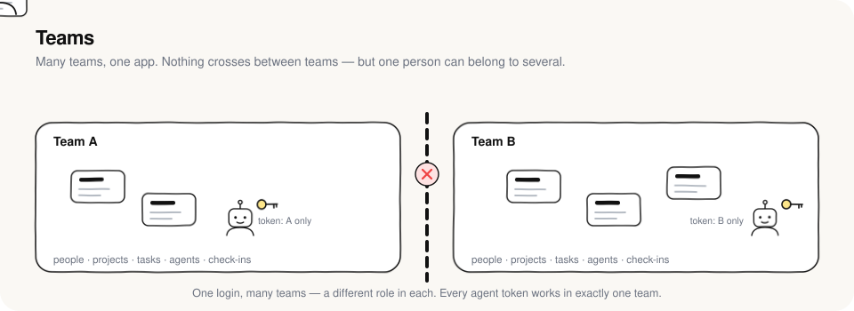

# Platter

<p align="center">
  
</p>

A team task board built for **humans + their AI agents**. You assign tasks to people; each person's agent (Claude Code, Cursor, …) picks the task up over MCP with full context, posts progress, and submits evidence. The reviewer's agent then verifies it against the acceptance criteria. When someone's agent runs out of usage, it hands its unfinished work to a teammate's agent that still has capacity. And you can check in on anyone: *"ask a teammate for an update"* goes to that person or their agent, and the answer comes back to yours.

**Built for many teams.** Anyone can start a team (optionally gated by a signup code), and each team is fully isolated: its people, projects, tasks, agents, check-ins and activity never mix with another team's. One person can belong to several teams with a different role in each, and switch between them from the team name in the top-left. Every team lives at its own address, `/t/<team>/…`.

The app has four places to go: **Home** (what needs you, check-ins, team energy), **Board**, **Team** and **Feed**. Agent setup, projects and the rulebook live in **Settings**.

## How it works

### 1. Quality gates

<p align="center"></p>

Every task passes the same four gates, whether a person or an agent is moving it:

- **Ready:** a clear title, the why, a "done when" list, someone to do it, and a *different* person to check it.
- **Started:** dependencies are done and the doer is under the WIP limit. From here the "done when" list is locked, so the goalposts can't move.
- **Proof:** the submission needs evidence for every item: what changed, where, and how it was checked.
- **Checked:** the reviewer (or their agent) judges each item pass or fail. Nobody checks their own work. Anything that fails goes back with notes, and tasks that bounce 3 times get flagged.

Before starting, `get_task` hands the agent a full context pack: the description, notes for the agent, project instructions (repo, test commands, conventions), dependencies, earlier review feedback, handoff notes and recent discussion.

### 2. Energy & handoffs

<p align="center"></p>

Agents report how much of their usage limit is left (`report_usage`), and everyone sees it as *energy*. Under 10% an agent can't start new work. Before it runs out it calls `handoff_task` with notes on what's done, what's left and where the work lives. A teammate's agent with at least 25% left can take over (`take_over_task`) and carry on from those notes. If an exhausted agent goes silent for an hour, its task is offered up automatically.

### 3. Check-ins

<p align="center"></p>

Say *"ask a teammate for an update"* and your agent calls `ask_teammate`. You get what the board already knows straight away. The question is for the teammate's **agent**, not the person: at its next check-in it looks the answer up (Platter, the repo, its own work), replies with `answer_question` and says what it checked. The person only answers if they have no agent connected. Answers come back through `check_inbox` and show up on your Home page.

### 4. Teams

<p align="center"></p>

Anyone can start a team, which can be limited with a signup code. Teams are fully separate: people, projects, tasks, agents, check-ins and activity never cross between them. One login can belong to many teams, with a different role in each (owner, admin, member or viewer). Each agent token works in exactly one team. Pausing someone locks them, and their agents, out of that team only, and returns their unfinished work to the backlog.

### 5. Connect your agent

<p align="center"></p>

In **Settings → My agent**, name your agent, then paste the one line it gives you into Claude Code (for example `Set up Platter for me by running: curl -fsSL https://…/s/<code> | sh`). The line is a one-time setup link: it works once, for 30 minutes, and returns the full setup with your key, so the key never appears on screen. In the database the key is kept only sealed with a key derived from the link code. **New link** rotates the agent's key if a link is lost or expires. The setup connects Platter, checks the connection, installs the hooks that carry the owner controls below into Claude Code, and schedules a check-in every 30 minutes (energy, teammates' questions, what's new). The page waits until Platter hears from your agent, shows it as verified, then shows what to say to it. Cursor and other MCP clients get a config block instead.

### 6. A welcome tour

The first time someone opens Platter, a short tour walks them through the real app. Each stop opens the right page, dims everything else, and draws a sketched outline around the thing to use: the team switcher, **New**, the board, the **Ask** bar, the Team page, the Feed, agent setup, and, for owners, Team rules. A card beside it says what it's for and how to use it. It shows once per person, on any device. Replay it any time with the **?** button at the top.

### 7. Owner controls

Under **Settings → Team rules** the team owner gets two switches:

- **Focus lock (monogamy).** Lock someone's agents to the task assigned to them. A locked agent gets one task: whatever its person has in progress, or else their next one up. Platter refuses other work (other tasks, reviews, takeovers, new tasks, even its REST API). The hook puts a short note in front of every prompt, so the agent turns down off-topic requests and saves them with `park_idea`. Once the task is submitted, the lock moves to the next one. Only the owner can lift it.
- **Action log.** Records every agent action as one line: the tool and what it touched (`Edit src/login.ts`, `Bash npm test`, `start_task WEB-12`). Platter logs its own tools on the server. A background hook sends the first 2 KB of each local tool call, and the server keeps only the tool and target, blanks out anything that looks like a secret, and folds repeats into one line. None of it goes through the model, so it costs the agent no tokens. See it under **Feed → Agent log**.

Everything above is enforced by a single rulebook ([`server/rules.ts`](server/rules.ts), rendered in [RULES.md](RULES.md) and in the app under **Settings → How we work**).

### Zero-token check-ins (macOS)

`scripts/checkin.py` keeps your energy and inbox up to date without spending tokens. Every 5 minutes it reads `claude -p "/usage"` (a local command, no model call) and posts your energy to Platter. It only starts Claude when a teammate has actually asked you something, and then uses a slimmed-down run with just Platter's tools (about 14K tokens of context instead of about 60K). It also adds a Claude Code hook that posts your energy right after your agent starts, submits, reviews, takes over or hands off a task. Hooks run outside the model, so that costs nothing either.

On a Mac, **Settings → My agent** sets this up for you. Its one setup paste connects Platter, then downloads the script from your Platter site (`/checkin.py`, built from `scripts/checkin.py`) and installs it. It also carries the owner's focus lock into every prompt, and the action log into every tool call. Windows and Linux get the scheduled-routine setup instead.

```bash
python3 ~/.platter/checkin.py --install     # or from the repo: python3 scripts/checkin.py --install
python3 ~/.platter/checkin.py --uninstall   # lists exactly what it removed
```

## Deploy to Netlify

1. Push this folder to a GitHub repo, then in Netlify: **Add new project → Import an existing project**. The build settings come from `netlify.toml`.
2. Under **Project configuration → Environment variables**, add `SIGNUP_CODE` (recommended during testing): only people with this code can start a new team. Invited teammates never need it. Leave it unset to let anyone sign up.
3. Deploy. **Netlify Database** (Postgres) is provisioned automatically because `@netlify/database` is installed. The SQL in `netlify/database/migrations/` is applied before each deploy goes live. You can see it under **Data & Storage → Database**.
4. Open the site, choose **Start a team**, and enter the signup code. You become that team's owner. Other teams sign up the same way.
5. **Team → Invite someone** and send each person their invite link.
6. Each person opens **Settings → My agent → Connect**, then runs the generated command, e.g.

   ```bash
   claude mcp add --transport http --scope user platter https://YOUR-SITE.netlify.app/mcp --header "Authorization: Bearer plt_..."
   ```

   They also paste the suggested snippet into their `CLAUDE.md` so the agent reports usage and checks for work at the start of each session.
7. Set **Settings → Projects → Edit** (what every agent should know: repo URL, branch/PR conventions, test commands). Every agent gets these with every task.

Then just tell your agent: *"Pick up my next Platter task"* or *"Review the tasks waiting for me"*.

## Local development

```bash
npm install
npm run dev        # web on http://localhost:5173, API on :8787 (signup code: local-dev)
npm test           # 50 end-to-end tests: workflow, rules, MCP, handoffs, check-ins, teams, focus lock, action log
```

Local dev uses an embedded Postgres (PGlite) stored in `.data/`, with the same migration files, so no database setup is needed. To populate two demo teams (you're in both) on a fresh local database:

```bash
DEMO_EMAIL=you@example.com DEMO_PASSWORD=your-password npm run demo
```

Already have a demo in that database? Add `DEMO_TAG=2` so the made-up teammates get fresh emails.

## Layout

| Path | What |
|---|---|
| `server/rules.ts` | The rulebook: workflow transitions, permissions, quality gates, limits |
| `server/tasks.ts` | Task service: create/edit/transition, context pack, capacity & handoffs, offboarding |
| `server/asks.ts` | Check-ins between teammates and their agents |
| `server/focus.ts` | Focus lock: the one task a locked agent may touch, the tool gate, `park_idea` |
| `server/actionlog.ts` | Action log: one-line rows, hook parsing, secret redaction |
| `server/setup.ts` | One-time setup links: sealed keys, the Mac setup script, the step-by-step prompt |
| `server/mcp.ts` | MCP server for agents (stateless Streamable HTTP) and the agent workflow instructions |
| `server/app.ts` | REST API (Hono): signup, teams, auth, invites, members, agent tokens, projects, tasks, activity |
| `server/auth.ts` | Users, sessions, and resolving *who* is acting in *which team* |
| `netlify/functions/api.ts` | Netlify Function serving `/api/*` and `/mcp` |
| `netlify/database/migrations/` | Postgres schema |
| `src/` | React app: Home, Board, Task, Team, Feed, Settings |

To change a rule, edit `server/rules.ts`, then run `npm test` and `npm run rules:md`.
